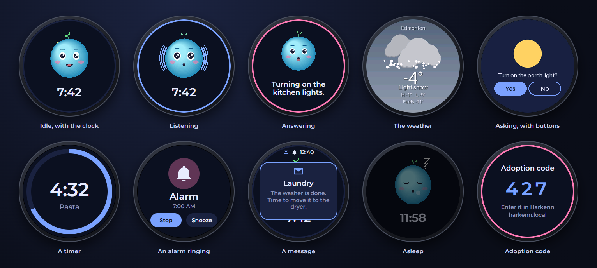

# Harkenn speaker firmware

Firmware for the Spotpear ESP32-S3 1.28" BOX: ESP32-S3 N16R8, a GC9A01 240×240 round display, CST816D touch and an
ES8311 codec. It is built with PlatformIO on the Arduino framework, using LVGL 9 and LovyanGFX. It speaks the
protocol in [docs/PROTOCOL.md](https://github.com/harkenn-project/server-docker/blob/main/docs/PROTOCOL.md) of
[server-docker](https://github.com/harkenn-project/server-docker), the server it talks to.

**Where to get one:** on AliExpress, as
[*Superior-ESP32 S3 1.28 Inch LCD Touch Screen Mini Speaker ESP32 S3 Xiaozhi AI Mini Speaker Support Deepseek*](https://www.aliexpress.com/item/1005010093339429.html)
(CA$41 when we bought ours). Check it's the 1.28" BOX: similar-looking Spotpear boxes with a 1.85" screen or no screen aren't
supported.

<p align="center">
  <a href="https://github.com/harkenn-project/server-docker/blob/main/docs/media/demo.mp4"></a>
  <br><em>A speaker introducing itself (1:39, with sound).</em>
</p>

## What it does

1. **Wi-Fi.** With no saved network, or when it can't join any of them for a minute, it opens the hotspot
   `Harkenn-XXXX` and keeps trying its networks every minute. Join the hotspot and open `http://192.168.4.1` for the
   speaker's own page (see *Its own web page* below). Networks pushed from the server are added to the saved list,
   with a static IP if they have one.
2. **Find the server.** It tries a saved address, then the `_harkenn._tcp` mDNS service, `harkenn.local`, and finally
   the DNS name `harkenn`, until a Harkenn server answers `/api/v1/ping`; it sets its clock from the reply. The
   speaker's page saves an address, and the server sends its own address in the config.
3. **Adoption.** It shows a 3-digit code. You enter the code in Harkenn, and the speaker saves its token in NVS.
4. **Online.** It loads its config and downloads what it needs: the character animations (KANI, see `app/kani.py` in
   server-docker) at the size the layout needs, the sound pack's clips (kept in flash) and the wake word model. Its
   boot sound plays once all of that is in. It then holds a WebSocket to Harkenn:
   - It applies config pushes live.
   - It sends status every 30 s and log lines every 2 s.
   - It handles the commands `reboot`, `identify`, `refresh_config`, `set_volume`, `play_state`,
     `update_firmware` (see *Updates* below), `factory_reset`, `card_rescan` and `card_format`.
   - The screen sleeps after `sleep_after_s` without a touch: dimmed with the character's sleeping animation,
     dimmed with only a big clock, or off (`sleep_display`).
5. **Wake word.** The wake word model (microWakeWord, run with TensorFlow Lite Micro) listens on the speaker itself
   while it's idle; no audio leaves the speaker until it hears the word. Harkenn sends the model and its sensitivity
   in the config.
6. **Only the nearest answers.** When several speakers hear the wake word, the one that heard it loudest answers.
   Each plays a *claim* the others can hear but people can't: three short tones between 18.6 and 19.8 kHz, the first
   two a fixed 50 ms apart (so a stray tone can't pass for one), the third later the quieter the speaker heard the
   word. Strongest wins: the others stay quiet, or stop if they'd started (Harkenn's `audio.wake_arbitration`, on by
   default). The codec runs at 48 kHz for this, filtered to 16 kHz for everything else.
7. **Away from home.** Set up for remote connection (in Harkenn), a speaker that can't find Harkenn for 2 minutes
   goes through the relay instead (see [RELAY.md](https://github.com/harkenn-project/server-docker/blob/main/docs/RELAY.md)):
   the same conversation, end-to-end encrypted so the relay can't read it, with animations, sounds and firmware
   coming through it too. A remote icon shows meanwhile; every 5 minutes it tries Harkenn directly and goes back
   when that works.
8. **Talking.** Say the wake word or tap the middle: the wake sound plays, then it streams what it hears to Harkenn
   until you stop talking (Harkenn decides when, after `audio.silence_s` of silence) or tap again. Harkenn answers
   with speech, which the speaker plays while the character talks; a tap stops it. When the assistant asks
   something, the speaker plays a soft cue and listens for the answer without the wake word.
9. **Timers and alarms.** They live on the speaker (src/timers.cpp), saved so they survive restarts and ring on time
   without Harkenn. Ringing shows a shaking bell with Stop and Snooze and stops on a tap, the wake word, "stop" (a
   small second model from Harkenn, listening only while ringing) or after 5 minutes (timers) / 15 (alarms). A
   countdown ring shows when a timer starts, and the status row at the top keeps an icon and the next timer's time
   left. Notifications from Harkenn drop in as a card; an envelope stays until it's tapped.
10. **Screens.** Along with an answer, Harkenn can send a picture (maybe animated) with tappable areas. It covers the
   home screen until it's dismissed or times out; tapping an area sends its label back as the next turn.
11. **Ringing.** An agent can ring the speaker: the character's ringing animation and a ring every 3 s, until someone
   taps to answer.
12. **Touch.** Tap the middle to talk or stop. Drag around the edge to change the volume; the speaker's own volume
   wins over the config unless the volume in the config changes.
13. **The SD card and the player.** A micro SD card is optional (src/card.cpp). At boot the speaker mounts it
   (1-bit SD mode on GPIO 17/18/21; the slot has no card-detect line) and tells Harkenn what's on it: music albums,
   soundscapes, meditations and photo albums ([MEDIA.md](https://github.com/harkenn-project/server-docker/blob/main/docs/MEDIA.md)).
   It must be FAT32; a card it can't read (exFAT, most cards over 32 GB) is reported as such, and `card_format` makes
   it FAT32. The player (src/player.cpp) decodes MP3 (minimp3) or WAV into its own stream at the codec's rate,
   resampled and filtered below 11 kHz so it stays clear of the wake word arbitration tones (src/resample.h):
   - music plays an album in order or shuffled (repeat off, all or one); a soundscape loops until stopped (a WAV with
     no gap at all); a meditation plays once; a sleep timer fades out over 8 s;
   - it fades out while the speaker listens, talks or rings, and pause, stop and skip fade briefly, so nothing clicks;
   - Harkenn sends `media` commands and the speaker reports `media_state` (PROTOCOL.md §10, §11).
   - The card is kept in step with Harkenn's media library (src/cardsync.cpp, PROTOCOL.md §12): Harkenn sends a plan
     of every file it wants there; the speaker deletes only files on its own manifest (`/.harkenn/manifest.json`),
     fetches what's missing a piece at a time over the WebSocket while idle, checks each SHA-256, and resumes after a
     restart. Files copied onto the card some other way are never touched. The plan and the manifest live in PSRAM.
14. **BOOT button.**
    - Short press: mutes or unmutes the mic (remembered across restarts). The character shows its muted animation.
    - Hold 3 s: power off (a press turns it back on).
    - Hold 6 s: restarts with the hotspot and its page up (for 10 minutes before it tries its saved networks).
    - Hold 11 s: factory reset, forgetting Wi-Fi, the token, the server URL and the passwords.

## Screens

[](docs/media/screens.png)

A mock-up of what the round screen shows, in the Midnight colour scheme, drawn from the firmware's layouts. The
weather and the Yes/No question are pictures Harkenn draws for the speaker; the character, layout and colours are
chosen per speaker or group in Harkenn.

## Its own web page

For break-glass access when Harkenn can't reach the speaker: `http://<its IP>` on its network, or the hotspot (above)
at `http://192.168.4.1`. It shows status and the recent logs, and lets you add, change or remove Wi-Fi networks (with
static IP), set the server address, log level, volume and brightness, ask Harkenn for an update or upload a
`firmware.bin`, restart, and factory reset.

- **Passwords.** It takes the Harkenn admin password or the speaker's own password, which Harkenn makes at adoption
  and shows on the speaker's page in Harkenn, where it can be changed. The speaker keeps only salted hashes of both. The
  hotspot's Wi-Fi password is the speaker password too. A speaker that isn't adopted yet has no passwords, so its page
  is open for the first-time setup.
- **Lockout.** After 3 wrong passwords it waits 30 s, doubling every other try; after 10 it locks until it's unlocked
  in Harkenn or factory reset with the button. Restarting doesn't skip a wait.
- **Back to Harkenn.** Changes made on the page are sent to Harkenn when the speaker reaches it, and win over what's
  set there. The hotspot goes off once it's connected to Harkenn again.

The page is plain HTTP: the speaker doesn't have the memory for HTTPS next to everything else. On the hotspot the Wi-Fi
link itself is encrypted (WPA2).

## Install

The easiest way: open [flash.mylife.ninja](https://flash.mylife.ninja) in Chrome or Edge, plug the speaker in and
follow the page ([harkenn-project/flash](https://github.com/harkenn-project/flash)). It checks the board (an ESP32-S3
with 8 MB of PSRAM and 16 MB of flash) before writing anything.

## Build and flash

```
python -m venv .venv
.venv\Scripts\pip install platformio
.venv\Scripts\pio run                 # build
.venv\Scripts\pio run -t erase        # first time only: wipes XiaoZhi (back it up first!)
.venv\Scripts\pio run -t upload       # flash over USB (COM4, see platformio.ini)
.venv\Scripts\pio device monitor      # serial log
```

## Updates

After the first install, update over Wi-Fi: upload `.pio/build/harkenn-speaker/firmware.bin` on Harkenn's
*Firmware* page and press *Install*. The speaker downloads it, checks the SHA-256, writes the spare app slot and
restarts; the previous version stays in the other slot. Bump `FW_VERSION` in `platformio.ini` for every build
you upload (Harkenn reads it from the image). The speaker's own page can take a `firmware.bin` upload too, for a
speaker that can't reach Harkenn.

**Releases.** Published releases live on this repo's `releases` branch as `latest.json` (and one manifest per
pre-release channel) plus `v<version>/firmware.bin`, and the complete install image the web flasher writes,
`v<version>/harkenn-speaker-<version>-install.bin` (bootloader, partition table and app; a stable release is also
`install/harkenn-speaker.bin`). After building a new `FW_VERSION`:

```
python tools/publish_release.py --push
```

**Channels.** Besides stable, there are three pre-release channels. Each has its own manifest on the `releases` branch,
and its versions carry a matching suffix:

| Channel | Manifest | Example version | For |
|---|---|---|---|
| stable | `latest.json` | `0.12.0` | everyone |
| beta | `latest-beta.json` | `0.12.0-beta.1` | nearly ready, for people happy to report problems |
| alpha | `latest-alpha.json` | `0.12.0-alpha.3` | new features as they come together |
| development | `latest-development.json` | `0.12.0-development.7` | every build, for testing |

```
python tools/publish_release.py --channel=beta --push
```

A Harkenn server follows one channel (its **Firmware** page) and offers the newest firmware on that channel or any
more stable one, so beta speakers move on to the next stable release. Versions compare as semantic versions:
`0.12.0-beta.10` > `0.12.0-beta.2`, and `0.12.0` > every `0.12.0-…`.

Each speaker asks Harkenn for updates once when it starts; if `latest.json` names a newer version it shows
*Update available* with *Install* and *Dismiss* (a dismissed version isn't offered again; a newer one is).

To restore the stock XiaoZhi firmware, write the full backup back to address 0 with esptool.

## Notes

- `src/ca_certs.h` holds the root certificates used to verify https: Let's Encrypt (ISRG Root X1 and X2) for
  servers, and Google Trust Services and SSL.com for the relay behind Cloudflare.
- Internal RAM is tight. TLS allocates in PSRAM (main.cpp), as do the wake word's tensor arena and stack and other
  large buffers; screens arrive over the WebSocket rather than a second HTTPS download. The status sent to Harkenn
  includes free internal RAM, its largest block and each task's unused stack.
- `lib/tflm` and `lib/esp-nn` are vendored by `tools/vendor_tflm.py`. `lib/minimp3` is only `minimp3.h` from
  [lieff/minimp3](https://github.com/lieff/minimp3) (CC0), at commit ea99364.
- The player's decoder and buffers are in PSRAM (its task's stack too: minimp3 keeps ~16 KB of scratch on it).
- `test/resample_test.cpp` checks the resampler and the MP3 decoding on a PC (MSVC or any C++17 compiler; the
  command is at the top of the file): the same output however the input is chopped up, a clean 1 kHz tone, nothing
  near the arbitration tones, and a seamless loop.
- If the picture comes out rotated or mirrored, change `DISPLAY_ROTATION` in `src/board.cpp`. Values 4-7 are the
  mirrored variants.
- Battery percentage assumes a 1:2 divider on GPIO1. Charging is read from GPIO41, assumed active-low. Both still
  need checking against real readings.

## Credits

Built with LVGL, LovyanGFX, the ESP32 Arduino core and more: see [CREDITS.md](CREDITS.md).


Created by **Master Magic** and **Pip**, Master Magic's AI apprentice, with the Harkenn contributors. Pip is the name we give the AI assistant that co-writes Harkenn.

## Support

Buy us a coffee on [GitHub Sponsors](https://github.com/sponsors/harkenn-project). Half of every donation goes to the
open-source projects Harkenn is built on; see
[SUPPORT.md](https://github.com/harkenn-project/server-docker/blob/main/SUPPORT.md).

## Licence

[MIT](LICENSE), copyright the Harkenn contributors. The libraries compiled in keep their own licences (see
[CREDITS.md](CREDITS.md)); the LGPL ones can be rebuilt and relinked from this source.
